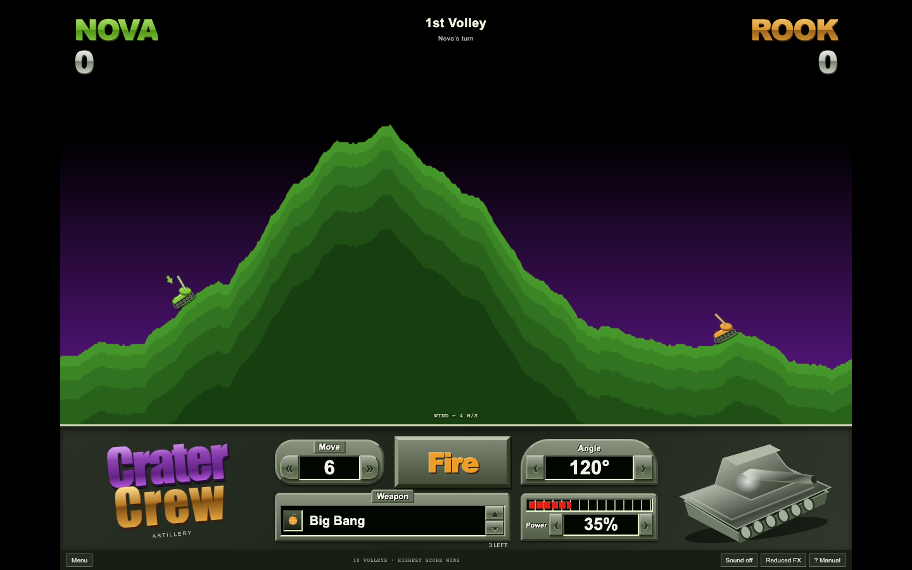
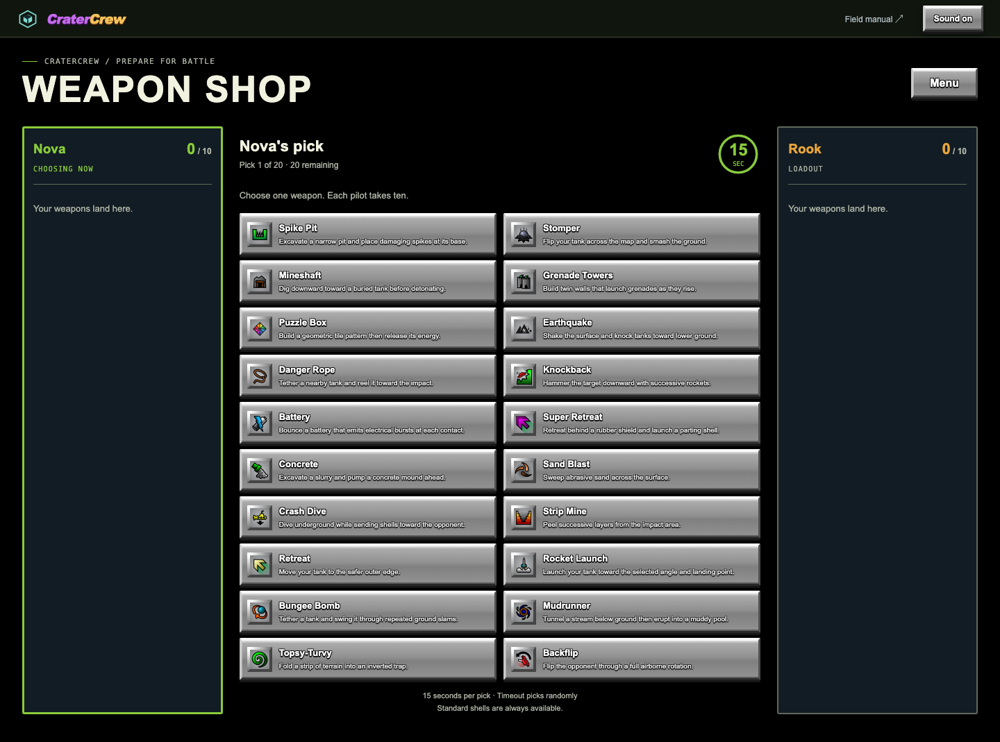
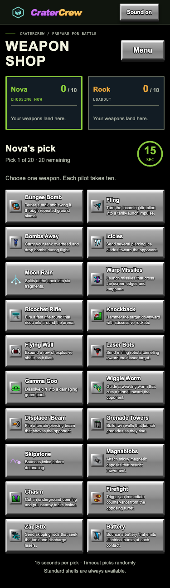
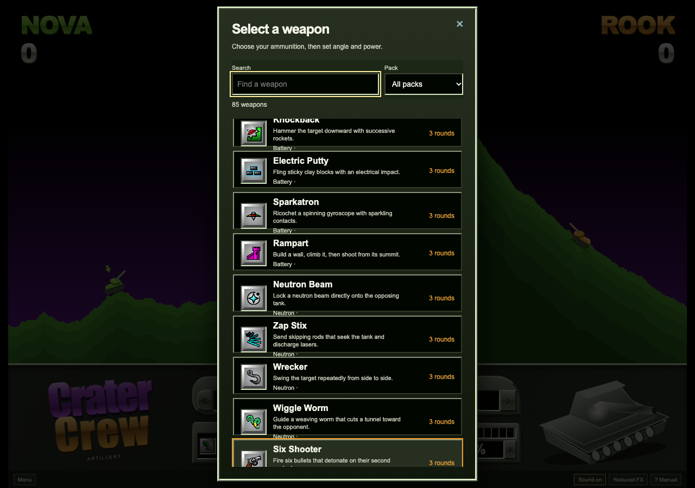
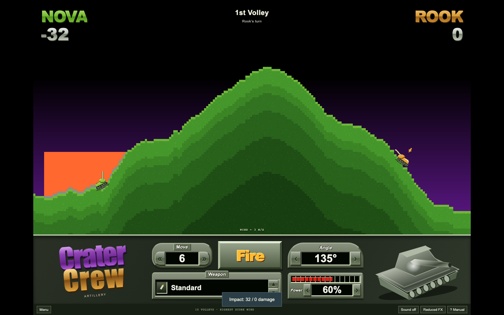
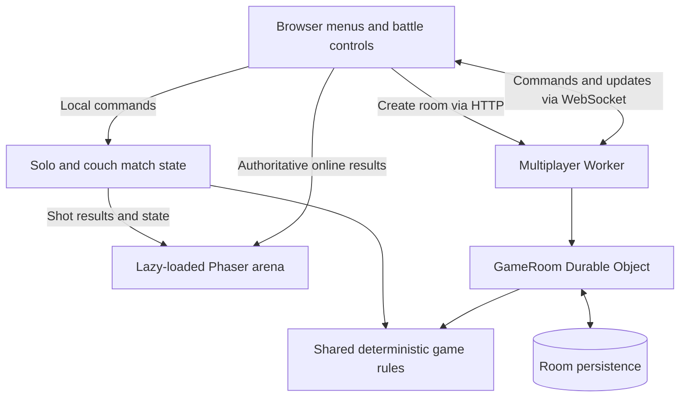
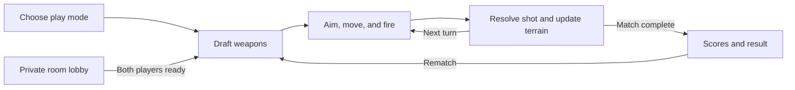

# CraterCrew

A browser artillery game with destructible terrain, a draftable arsenal, and private two-player duels — wrapped in a retro metallic battle console.

Built with TypeScript, Phaser, Vite, and Cloudflare Durable Objects. Play against a bot, share a screen with a friend, or run private multiplayer locally.

---

## Table of Contents

- [Screenshots](#screenshots)
- [Project Overview](#project-overview)
- [Key Features](#key-features)
- [How to Play](#how-to-play)
- [Tech Stack](#tech-stack)
- [System Architecture](#system-architecture)
- [Match Lifecycle](#match-lifecycle)
- [Folder Structure](#folder-structure)
- [Multiplayer & Storage](#multiplayer--storage)
- [API Reference](#api-reference)
- [Environment Variables](#environment-variables)
- [Local Development](#local-development)
- [Testing & Quality Checks](#testing--quality-checks)
- [Project Scope](#project-scope)
- [Credits & References](#credits--references)

---

## Screenshots

### Battle Console



### Weapon Draft — Desktop



### Weapon Draft — Phone



### Arsenal Reference



### Terrain & Weapon Effects



These are development captures; individual layouts may differ from the latest build.

---

## Project Overview

CraterCrew turns each shot into a terrain puzzle: choose a weapon, account for wind, set your angle and power, and watch the battlefield change. Craters, tunnels, defenses, and tank movement all affect the next turn.

| Play Mode           | Experience                                                                              |
| ------------------- | --------------------------------------------------------------------------------------- |
| Solo                | Duel an aiming bot in your browser                                                      |
| Couch duel          | Two players take turns on the same device                                               |
| Private online room | Share an invitation and play from separate browsers with the multiplayer Worker running |

Solo and couch play run entirely in the frontend. Private rooms use an authoritative multiplayer service with shared game rules.

---

## Key Features

### Weapons & Drafting

- 85 playable weapons: six original weapons and 79 reference weapons with matching icons.
- A randomized pool of 20 special weapons before each match and rematch.
- Alternating picks give each player ten special weapons.
- A 15-second pick timer with automatic random selection on timeout.
- Solo Random deals the remaining weapons to both tanks and reveals their completed loadouts before battle.
- Unlimited standard shells and three rounds per drafted special weapon.
- Searchable arsenal with pack filters and weapon details.

### Battlefield & Simulation

- Seeded terrain and wind.
- Persistent material terrain, tunnels, overhangs, and defenses.
- Terrain-following tank movement, movement fuel, and fall damage.
- Deterministic weapon handlers with bounded shot simulation.
- Projectile paths and timed terrain, damage, and motion events.

### Battle Console

- Inline angle and power controls, previous/next weapon selection, and a fire button.
- Mouse, keyboard, and responsive touch controls.
- Synthesized weapon sounds with immediate mute.
- Reduced-effects support and a field manual for aiming and terrain tactics.
- Scores, victory/draw results, and rematches.

### Private Multiplayer

- Invitation codes, callsigns, and a ready-up lobby.
- Server-validated commands and revision checks.
- Reconnection to the same seat when refreshing the same tab.
- 60-second turns, 30-second disconnect forfeits, and two-hour room expiration.
- Persisted room state and hibernating WebSockets.

---

## How to Play

1. Choose solo, couch duel, or a private room.
2. Draft your special weapons.
3. Select a weapon, adjust angle and power, and fire.
4. Move when needed and use the changing terrain to your advantage.
5. Play ten volleys each; the highest score wins. Both tanks begin at zero points.

| Input               | Action                                                  |
| ------------------- | ------------------------------------------------------- |
| Left / Right arrows | Adjust angle                                            |
| Up / Down arrows    | Adjust power                                            |
| Space               | Fire                                                    |
| A / D               | Move the active tank                                    |
| On-screen controls  | Aim, choose weapons, move, and fire with mouse or touch |

**Angle reference:** `0°` fires right, `90°` fires up, and `180°` fires left.

---

## Tech Stack

| Layer               | Technology                    | Purpose                                                      |
| ------------------- | ----------------------------- | ------------------------------------------------------------ |
| Language            | TypeScript                    | Shared types and rules across client and Worker              |
| Interface           | HTML + CSS                    | Menus, dialogs, and responsive console controls              |
| Rendering           | Phaser 3                      | Battlefield drawing and projectile animation                 |
| Development & Build | Vite                          | Local dev server and frontend bundling                       |
| Multiplayer Service | Cloudflare Workers + Wrangler | Room routing and local backend development                   |
| Room Storage        | SQLite-backed Durable Objects | Authoritative room state and persistence                     |
| Transport           | WebSockets                    | Room updates and player commands                             |
| Audio               | Browser-synthesized sound     | Weapon launch, impact, and effect cues                       |
| Unit Tests          | Vitest                        | Rules, terrain, rooms, weapons, and client logic             |
| Browser Tests       | Playwright                    | Gameplay, layouts, drafting, synchronization, and reconnects |
| Formatting          | Prettier                      | Consistent source and documentation formatting               |

---

## System Architecture



The Worker resolves online shots and broadcasts their paths, timed events, and resulting state. Clients animate those results. Scores and terrain changes are computed by the shared rules on the server.

Phaser loads when the battlefield is needed. The arena uses fixed logical dimensions, redraws terrain on state changes, and does not use a physics engine or a per-frame network stream. Reduced effects suppress particles while preserving online animation timing.

---

## Match Lifecycle



Online rooms own player identity, readiness, deadlines, revisions, and rematch state. Local matches use the same deterministic gameplay modules without a network connection.

---

## Folder Structure

```text
CraterCrew/
├── src/
│   ├── client/
│   │   ├── main.ts                  # Menus, controls, and network transport
│   │   ├── arena.ts                 # Phaser battlefield scene
│   │   ├── state.ts                 # Client state transitions
│   │   ├── weapon-draft-view.ts     # Draft interface
│   │   ├── weapon-presentation.ts   # Weapon sound and visual families
│   │   ├── sound.ts                 # Synthesized audio
│   │   └── style.css                # Responsive interface styling
│   └── shared/
│       ├── game.ts                  # Match rules, terrain, weapons, and bot
│       ├── materials.ts             # Material grid and persistent terrain
│       ├── reference-weapons.ts     # Reference inventory and tuning
│       ├── weapon-draft.ts          # Deterministic draft rules
│       ├── weapon-engine.ts         # Weapon resolution
│       ├── weapon-packs/            # Weapon-specific handlers
│       ├── weapon-timeline.ts       # Timed simulation events
│       └── room.ts                  # Lobby and authoritative room rules
├── worker/
│   └── index.ts                    # HTTP routes, WebSockets, storage, alarms
├── public/
│   ├── weapons/                    # Weapon icons
│   └── ui/                         # Interface artwork
├── tests/
│   ├── *.test.ts                   # Unit and regression tests
│   └── e2e/                        # Playwright browser tests
├── docs/
│   ├── previews/                   # Development screenshots
│   ├── weapon-study/               # Sources and reconstruction evidence
│   └── superpowers/plans/          # Implementation plans
├── .env.example                    # Local multiplayer endpoint example
├── playwright.config.ts            # Browser tests and local test servers
├── wrangler.toml                   # Worker bindings and allowed origins
└── package.json                    # Scripts and dependencies
```

---

## Multiplayer & Storage

| Data                                    | Location                |
| --------------------------------------- | ----------------------- |
| Solo and couch match state              | Browser memory          |
| Callsign, audio, and motion preferences | Browser local storage   |
| Per-room reconnect credentials          | Browser session storage |
| Authoritative online room state         | Durable Object storage  |

An invitation opens the join form so a player can enter a callsign. The invitation code provides access to the private room; reconnect credentials preserve a player's seat in the same tab.

The Worker checks allowed origins, command revisions, player actions, and message limits. Room alarms handle deadlines and expiration.

---

## API Reference

| Method / Transport | Route                      | Purpose                                                     |
| ------------------ | -------------------------- | ----------------------------------------------------------- |
| `GET`              | `/health`                  | Return service health as `{ "ok": true }`                   |
| `POST`             | `/api/rooms`               | Create a room and return its invitation code                |
| WebSocket upgrade  | `/api/rooms/:code/connect` | Join or reconnect using `token` and `name` query parameters |

Room creation and connection require an allowed browser origin. The client handles player commands and incoming room updates over the WebSocket.

---

## Environment Variables

| Variable               | Configuration                       | Purpose                                                          |
| ---------------------- | ----------------------------------- | ---------------------------------------------------------------- |
| `VITE_MULTIPLAYER_URL` | Optional frontend `.env` value      | Multiplayer endpoint; use `http://localhost:8787` locally        |
| `ALLOWED_ORIGINS`      | Worker variables in `wrangler.toml` | Comma-separated browser origins allowed to create and join rooms |

On `localhost` and `127.0.0.1`, the client defaults to `http://localhost:8787` when no endpoint is supplied. The checked-in Worker configuration permits the local frontend ports `5173` and `4173`.

---

## Local Development

Requires **Node.js 22.12 or newer** and npm.

### 1. Clone & Install

```sh
git clone https://github.com/yuvrajsatyapal/CraterCrew.git
cd CraterCrew
npm ci
```

### 2. Start the Frontend

```sh
npm run dev
```

Open [localhost:5173](http://localhost:5173). Solo and couch duels are ready immediately.

### 3. Start Private Multiplayer Locally

In a second terminal:

```sh
npm run dev:worker
```

Create a room in the game, copy its invitation, and open it in a second browser or browser profile. Enter both callsigns and ready both players.

For an explicit endpoint configuration, copy the example before starting Vite:

```sh
cp .env.example .env
```

### 4. Preview a Local Build

```sh
npm run build
npm run preview
```

Open [localhost:4173](http://localhost:4173). Keep the local Worker running if testing private rooms. These commands build and serve locally.

---

## Testing & Quality Checks

```sh
# Check frontend and Worker types
npm run typecheck

# Run unit and regression tests
npm test

# Compile and bundle the frontend
npm run build

# Install the browser and run end-to-end tests
npx playwright install chromium
npm run test:e2e
```

Playwright starts a frontend preview and a local Wrangler server automatically. Build first so the preview has current output. Online tests use isolated browser contexts to exercise synchronization and reconnection. Failure traces and screenshots go to the ignored `test-results/` directory.

To check README formatting:

```sh
npx prettier --check README.md
```

Verification notes are available in [gameplay verification](docs/verification.md), [weapon draft verification](docs/weapon-draft-verification.md), and [weapon audiovisual verification](docs/weapon-audiovisual-verification.md).

---

## Project Scope

CraterCrew is a playable learning project centered on local duels and private rooms. Public matchmaking, accounts, and ranked ladders are outside its current scope. Physical phone performance still needs device testing.

The multiplayer service includes per-socket limits. A public launch would need an account-level room-creation abuse policy in addition to these controls.

---

## Credits & References

- The interface and battlefield use original SVG and procedural drawings; audio is synthesized.
- The 79 reference weapon names and matching icons come from the supplied [BlitWise developer blog](https://www.blitwise.com/mikes-dev-blog). Source URLs and pack membership are recorded in [the source inventory](docs/weapon-study/sources.json).
- Weapon mechanics and numerical tuning are reconstructed for this learning project. They do not represent recovered original source code or the full original game's catalog. See [weapon study verification](docs/weapon-study/verification.md).
- Sound and animation reconstruction references the supplied [Pocket Tanks All Weapons recording](https://www.youtube.com/watch?v=CnYdKTtlbb8). Sounds are synthesized approximations; original waveforms and exact animation timings have not been recovered.
